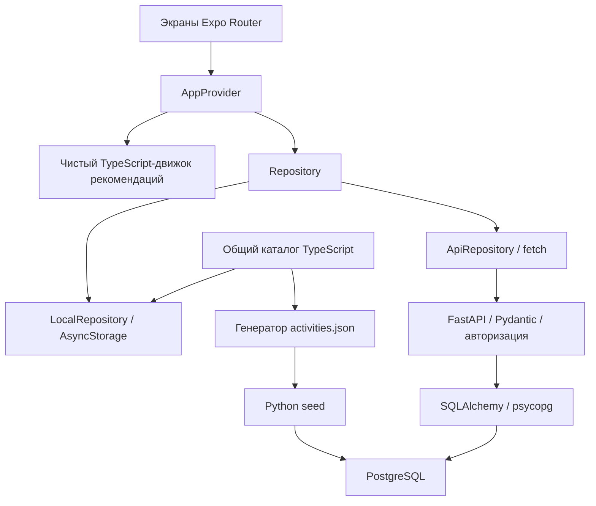

# Архитектура ЧтоДальше

## Общая схема

## Клиент

Маршруты `app/` экспортируют экраны из `src/features/`. UI вызывает действия `useApp()`, не содержит SQL и не обращается непосредственно к базе.

`AppProvider` сохраняет интересы, избранное и историю через интерфейс `Repository`. Интерфейс меняется после успешной записи. Повторные нажатия блокируются во время запроса. Повторная попытка использует тот же UUID истории и то же желаемое состояние избранного; при успешном повторе подбора открывается экран результата.

`LocalRepository` и `ApiRepository` реализуют один контракт. Ключ и версионированный формат локального хранения `whatnext.demo.v1` сохранены: существующие данные деморежима остаются доступными. Очередь локальных записей защищает от потери обновлений, повреждённые данные не перезаписываются пустыми.

`ApiRepository` читает и записывает REST API, валидирует ответы и читает длинные списки страницами. Каждый HTTP-запрос имеет тайм-аут 15 секунд. Параллельные запросы используют одну операцию создания/восстановления сессии. Токен хранится под `whatnext.api.session.v1:<URL>`; разные серверы и деморежим имеют раздельные данные. Код 401 не приводит к созданию нового аккаунта или удалению сохранённого токена.

Без `EXPO_PUBLIC_API_URL` выбирается деморежим. При заданном адресе используется API; неверный адрес и ошибки сети показываются явно. Пользователь может переключиться в деморежим, а затем вернуться к своему серверному аккаунту. Успешно выбранный режим хранится под прежним ключом `whatnext.selected-mode.v1`.

## Backend

FastAPI организован через пять APIRouter: `sessions`, `activities`, `preferences`, `favorites`, `history`. Pydantic задаёт входные и выходные DTO, значения перечислений, числовые границы и формат дат. В JSON — camelCase, в Python и PostgreSQL — snake_case.

SQLAlchemy использует обычные синхронные сессии и psycopg 3. Синхронные обработчики FastAPI выполняются в пуле потоков. На HTTP-запрос создаётся одна сессия, после ошибки выполняется rollback. Изменения явно фиксируются через commit. Подключение настраивается `DATABASE_URL`; допускается только PostgreSQL.

Миграции применяются Alembic отдельно от обработки HTTP. `python -m app.bootstrap` выполняет `upgrade head` и загружает каталог. В контейнере bootstrap вызывается перед Uvicorn. Повторное применение не очищает пользовательские записи.

База содержит шесть таблиц:

| Таблица                | Назначение                                                                         |
| ---------------------- | ---------------------------------------------------------------------------------- |
| users                  | Анонимные пользователи                                                             |
| user_sessions          | SHA-256 токенов и владельцы сессий                                                 |
| activities             | Каталог с ограничениями участников, времени, стоимости и массивами мест/настроений |
| user_preferences       | Интересы, онбординг и последние обычные фильтры                                    |
| favorites              | Уникальные пары пользователь/занятие                                               |
| recommendation_history | UUID, дата, параметры и chosen; ключ пользователь/UUID                             |

Миграция задаёт внешние ключи, индексы, числовые ограничения, допустимые категории и массивы, проверку JSON-фильтров. Удаление пользователя удаляет его личные записи; удаление используемой активности ограничено, архивирование сохраняет ссылки истории.

## Авторизация и владение данными

При первом серверном запуске `POST /sessions/anonymous` создаёт пользователя, настройки и криптографически случайный токен. Клиент получает токен; PostgreSQL хранит только его SHA-256. Каждый `/me/*` запрос проверяет Bearer и определяет user_id на сервере.

Все запросы к личным данным включают условие владельца. Нельзя выбрать чужого пользователя через тело запроса или URL. Случайно совпавший UUID истории другого пользователя не позволяет его изменить: ключ истории составной. Клиент не подключается к PostgreSQL и не получает параметры соединения. База доступна через серверный слой.

Токен в MVP действует до удаления записи сессии; регистрации, паролей и восстановления анонимного аккаунта нет. API для опубликованного окружения должен использовать HTTPS. CORS разрешает указанный список браузерных origin; мобильные приложения не используют браузерный CORS.

## Сохранение и повторные запросы

PUT избранного выполняет `on conflict do nothing`. PUT истории сохраняет новый UUID и не изменяет уже существующую запись: повторная доставка не снимает ранее поставленную отметку chosen. PATCH меняет chosen только у собственной записи. DELETE истории ограничен текущим user_id.

Ответы API не раскрывают SQL, DSN или stack trace. Ошибки валидации возвращают 422, авторизации — 401, отсутствующих записей — 404, ограничений базы — 409, подключения базы — 503. Интерфейс дополнительно показывает сообщения, соответствующие действию, и повторную попытку.

## Рекомендации

Алгоритм находится в `src/features/recommendations/engine.ts` и сохраняет прежнее поведение:

1. Валидация типизированных фильтров.
2. Жёсткая фильтрация по участникам, длительности, стоимости на человека и месту.
3. Score: настроение +3, категория интереса +2, дополнительные подходящие теги +1, близкая длительность +1. Веса находятся в `SCORING`.
4. Исключение показанных в текущей серии ID, сортировка оставшихся и случайный выбор из десяти лучших.

Результат различает `success`, `empty`, `exhausted`, `invalid`. Интересы и настроение не являются жёсткими фильтрами. Пустая выдача не ослабляет ограничения.

Серия живёт в памяти, история сохраняется. Прошлая история не исключает идеи навсегда. Обычный подбор сохраняет последние условия. Повтор открывает форму. «Удиви меня» снимает ситуативные ограничения и не перезаписывает обычные последние фильтры.

## Общие данные и учебное расширение

`src/data/catalog.ts` остаётся единственным исходным каталогом. Стабильные числовые коды задают UUID. `scripts/generate-catalog.ts` выпускает JSON для backend; Python валидирует его и загружает через upsert. `seed:check` проверяет совпадение двух представлений.

Для обучения код серверных групп можно изучать отдельно: каталог, настройки, избранное, история. Добавление новой функции обычно требует DTO, обработчика, запроса SQLAlchemy и теста. Если позднее переносить рекомендации на Python, выделите сервис рекомендаций и HTTP-адаптер; текущий чистый движок и локальный режим позволяют делать это поэтапно.
