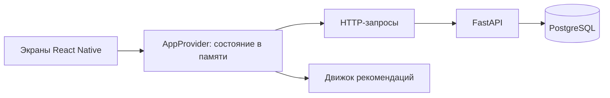

# Архитектура ЧтоДальше

## Клиент

`AppProvider` загружает каталог, настройки, избранное и историю с сервера. После успешной записи обновляет React-состояние, чтобы экран сразу показал результат. Это состояние живёт только до закрытия приложения; постоянных данных на устройстве нет.

`ApiRepository` содержит обычные GET/PUT/PATCH/DELETE-запросы. Адрес берётся из `EXPO_PUBLIC_API_URL`, по умолчанию `http://localhost:8000`. При запуске не создаются аккаунты или сессии. Запросы не содержат токенов. У каждого запроса есть тайм-аут 15 секунд, списки читаются страницами по 500 записей.

Ошибка загрузки показывает кнопку повтора. Ошибка записи оставляет прежнее состояние и позволяет повторить запрос. UUID истории создаётся один раз на результат: повтор отправки не добавляет дубликат, даже если сервер сохранил запись, а ответ потерялся.

Движок рекомендаций — чистая функция TypeScript. Он отбирает активные занятия по обязательным условиям, ранжирует по интересам и настроению и исключает уже показанные идеи серии. История каждого успешно выданного результата записывается через API. Каталог в клиентский runtime поступает из PostgreSQL; исходный TypeScript-каталог нужен для seed и тестов.

## Backend

FastAPI получает запрос, Pydantic проверяет JSON, обработчик выполняет запрос SQLAlchemy к PostgreSQL и возвращает ответ. Python использует snake_case, JSON — camelCase для совместимости с приложением.

Четыре группы маршрутов: `/activities`, `/preferences`, `/favorites`, `/history`. Вместе с `/health` — 12 HTTP-операций. Примеры: [API.md](backend/API.md).

Для учебной версии используется один общий профиль с постоянным UUID из `app/profile.py`. Регистрации, проверки токенов и определения пользователя по устройству нет. Данные всех клиентов общие; изменения другого клиента видны после повторной загрузки приложения.

## Таблицы

| Таблица                  | Назначение                                                    |
| ------------------------ | ------------------------------------------------------------- |
| `users`                  | Строка общего профиля; также сохранены профили прежней версии |
| `activities`             | Каталог занятий и условия подбора                             |
| `user_preferences`       | Интересы, прохождение онбординга и последние фильтры          |
| `favorites`              | Связь профиля с сохранённым занятием                          |
| `recommendation_history` | Выданные идеи, условия, время и отметка выбранного плана      |

Дубли избранного исключает первичный ключ. Повтор PUT истории не создаёт новую запись и не снимает `chosen`. Несколько рекомендаций одного занятия имеют разные UUID истории. Очистка истории затрагивает общий профиль, сохраняя избранное и настройки.

## Миграции и каталог

Alembic управляет версиями схемы. `python -m app.bootstrap` применяет миграции, затем загружает каталог через upsert. Общий профиль создаётся миграцией. Повторный bootstrap сохраняет его данные.

Начальная миграция отражает прежнюю схему. Следующая создаёт общий профиль и удаляет таблицу токенов. Старые профили и их данные сохраняются, но не объединяются автоматически с общим профилем.

Единственный исходный каталог — `src/data/catalog.ts`. Генератор обновляет `backend/data/activities.json`; `seed:check` проверяет совпадение. Архивные занятия сохраняются для открытия старого избранного и истории.
